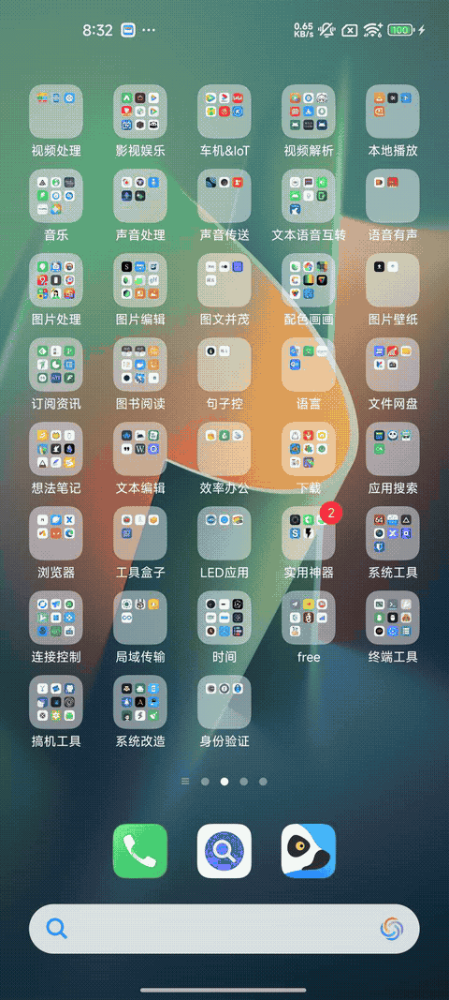

# pilotdroid

[](https://github.com/mofanx/pilotdroid/actions/workflows/ci.yml)
[](LICENSE)

> **English**: a device-side Android automation stack — persistent binary
> protocol + on-device batch execution, built to break uiautomator2's
> per-call HTTP/JSON-RPC round-trip ceiling. Three surfaces over one device
> backend: `pilotdroid-cli` (one-shot ops + stdio MCP server, 30 tools),
> a Rust facade (`pilotdroid-agent`), and a uiautomator2 drop-in Python shim
> (`from pilotdroid import u2shim`; xpath = host-side approximation
> subset, not the u2 plugin pipeline).
> Same-script wall-clock vs real u2 on retail devices: **8.8× USB /
> 4.7–7.4× adb-TCP** (op-mix sensitive, `spike/e2e/RESULTS-M7.md`). Details
> in Chinese below; protocol contract: `docs/02-protocol.md`.

用 Rust 独立开发的 Android 自动化控制库 / CLI。借鉴 uiautomator2-rs 与 scrcpy 的工程思路，但不照抄其架构——核心目标是通过**自研持久二进制协议 + 设备端批量执行**，突破「每条指令一次 HTTP/JSON-RPC 往返」的性能天花板（u2 实测 click ~263ms、exists ~26ms、screenshot ~186ms），拿到数量级的延迟改善。

## Demo — live frame stream



Captured from `python3 spike/e2e/live-view.py <serial>` (MJPEG → browser)
on a retail device — swipes injected mid-stream. The same frames are
exposed to MCP clients via `stream_read`.

## 安装

- **预编译 CLI**（推荐）：从 [Releases](https://github.com/mofanx/pilotdroid/releases)
  按平台下载，`chmod +x` 入 PATH：

  | 平台 | 产物 |
  |---|---|
  | Linux x86_64 | `pilotdroid-cli-linux-x86_64` |
  | macOS arm64 | `pilotdroid-cli-macos-arm64` |
  | Windows x86_64 | `pilotdroid-cli-windows-x86_64.exe` ⚠️ compile-verified only |

  > **macOS 注意**：Release 二进制未签名，浏览器下载后首次运行会被
  > Gatekeeper 拦截——先执行 `xattr -d com.apple.quarantine pilotdroid-cli`
  > 再运行（或直接用下方 Homebrew 安装，无此问题）。

  > **Windows 注意**：`.exe` 未签名，首次运行会被 SmartScreen 拦截——
  > 点"更多信息 → 仍要运行"；命令行下载的可用 PowerShell
  > `Unblock-File pilotdroid-cli-windows-x86_64.exe` 解除标记。
  > 该产物为 **compile-verified only**：CI 构建通过但尚未在 Windows
  > 实机跑过，如遇运行问题请提 issue。

- **Homebrew**（macOS）：

  ```
  brew install mofanx/pilotdroid/pilotdroid
  ```

  CLI 已内嵌 agent.jar，一条命令完成部署+八步自检，无需 `--jar`：

  ```
  pilotdroid-cli -s <serial> setup
  ```
- **源码构建**：`cargo install --locked --path crates/pilotdroid-cli`（Rust 1.74+）。
- **Python u2 shim**：`pip install pilotdroid`（已上 PyPI；
  亦可用 git 安装 `pip install "git+https://github.com/mofanx/pilotdroid#subdirectory=python"`）

  仓库内可用 `pip install ./python`；随后 `from pilotdroid import u2shim`。
- agent.jar 亦可单独取用：Release assets 或仓库 `agent/agent.jar`（与 CLI 内嵌字节一致）。

## 定位

- **协议与架构自主**：ADB client 层 vendor 成熟实现（`adb_client` 等，Apache/MIT），差异化投入集中在设备端 agent 与 RPC 协议层。
- **设备端 agent：Java dex 为能力主体**（实测裁决：`app_process` + `InputManagerGlobal` 注入 p50≈3ms、30/30 成功；`/dev/input` 写在 Enforcing 下被 SELinux 全拒）。Rust native 仅为可选监听件。
- **能力探测 + 降级链**：注入（InputManagerGlobal → 隐藏 API 兜底 → UiAutomation → `input` 命令）、截图（resident → exec-out screencap → 帧流）均按设备能力运行时探测降级，以实测为准。

## 三种调用面（M5，ADR-007）

同一设备后端，三种接入形态，按调用方选：

| 形态 | 适合 | 开销 | 入口 |
|---|---|---|---|
| `pilotdroid-cli agent <op>` | 人工/脚本单发 | ~85ms/call（含 fwd+connect+HELLO） | 子进程每次拉起 |
| `pilotdroid-cli serve`（stdio MCP） | **AI agent 一行接入** | 持久会话摊销 ~0 | `pilotdroid-cli serve` + JSON-RPC 30 工具 |
| Rust `pilotdroid-agent` facade | Rust 库内嵌 | 持久 Session | `Device::with_transport(..).session()` |

另有 **u2 兼容 shim**（`compat/u2shim.py`，host 侧翻译层，`pip install ./python`
后 `import pilotdroid`）：u2 脚本零改动跑通。
支持集（明确不暗示全覆盖）：`click/long_click/swipe/press/set_text/dump_hierarchy/
screenshot/app_start/app_stop/app_current/info` + selector `text/resourceId/
description/className/packageName/scrollable/index` + `d(scrollable=True).scroll.*`。
M6 真实脚本对拍：**23/24 op 通过**（`spike/e2e/m6-compat.json`）；方法级矩阵见
`compat/SUPPORTED.md`。**`d.xpath` 为 host-side 近似子集**（xpath-lite：每次查询
一次 dump+ElementTree，覆盖 text/@id/%模糊%/contains()/parent()/scroll_to，
高级轴显式 NIE；非 u2 插件管线，非 drop-in 承诺）。

定位：适合把存量 u2 脚本/测试迁到 pilotdroid 后端换取延迟收益——与上游
`mobile_tests/` verbatim 对拍 **22 pass / 0 fail / 8 skip**（零售真机实测；
8 skip 全为上游自带标记，其中 implicitly_wait/枚举/count/watcher 4 面已实现
并有单测+真机 parity 覆盖）。全部偏差与边界逐条如实登记 `compat/SUPPORTED.md`。

MCP client 挂接（mcpServers 片段，二进制名 `pilotdroid-cli`，cargo install 后在 PATH）：

```json
{"mcpServers": {"pilotdroid": {"command": "pilotdroid-cli", "args": ["serve"]}}}
```

多设备场景补 `-s`：`"args": ["serve", "-s", "<serial>"]`（`-s` 是 serve 子命令选项）。
**一设备一 client**：agent 单 conn 顶替语义（ADR-007）——同一设备上第二个
serve/shim/verify 连接会顶掉前一个；被顶替方下一次 op 显式报 io error，
serve 会在下一 call 惰性重连夺权（M10 起），并在 stderr 打 conn-lost
warn（M12 起；stdout 仍只有 JSON-RPC，不污染协议流）。**两个 serve
实例并存会来回夺权 ping-pong**（如同时开 Cursor+Claude Desktop 指向
同一设备）——功能不丢但每次 call 多出重连延迟，请保持一设备一 serve。

经官方 python `mcp` SDK 与 Devin CLI 实测握手通过（`spike/e2e/mcp_client_check.py`
+ `agent_e2e_transcript.txt`）；initialize 应答同时透出 `agentVer`（设备 jar 版本）。

### AI agent loop 模板（M31）

weditor/u2inspector 在 AI 时代的等效物不是 GUI 查看器，而是一段可跑的
**观察→选元→操作→验证** 闭环。`spike/e2e/agent-loop/` 提供两个样板：

- `inspector.py` —— 最小闭环：`describe_screen` 打印 dense 编号元素表
  （与 `screenshot_annotated` 叠框同一编号空间，模型视觉与动作面可直接
  对齐），`--tap N` 按编号点击中心点，`verify_after` 判定后置条件。
- `loop.py` —— eval harness v1：10 个确定性 ApiDemos 任务（导航/开关/
  单选/复选/文本输入/弹窗/toast/返回/stream+watch 并存）跑同一
  policy loop，输出逐题 PASS/FAIL+耗时与总成功率。真机 ba0d072d
  （MIUI/API34）基线 **10/10**（`spike/e2e/RESULTS-M17-u2suite.md` §附11）。
- `loop_v2.py` —— eval v2 难度爬升（跨 app 导航/SoM 编号消费/stale
  快照重验/滚动查找/时序 toast/脏杀注入/后台恢复），35/35 基线。
- `loop_v3.py` —— eval v3：在 v2 全集上加**随机化区分度**任务
  （`random_index_pick` 随机列表项 tap_index、`random_checkbox_state`
  随机 checkbox 索引+`verify_after` state 谓词断言翻转），失败记录带
  前台包名归因（`fg=` 字段，外部 app 抢前台不再静默）；`--portable`
  跑无 ApiDemos 依赖的 Settings 子集（多设备行）。

```bash
python3 spike/e2e/agent-loop/inspector.py            # 列元素
python3 spike/e2e/agent-loop/inspector.py --tap 6 --expect-text "Add"
PILOTDROID_SERIAL=<serial> python3 spike/e2e/agent-loop/loop.py
```

inspector-loop 配方（模型视角最小五拍）：

```
describe_screen → 选元素：取元素 JSON 的 `i` 字段（= list_elements 编号）
  → list_elements            # 首次 tap_index 前必备：填快照（stale-guard 的比对基线）
  → tap_index {i}            # stale-guard 防错点；无 `i` 的元素才走 tap {x,y} 中心点
  → verify_after {
      action:{tool:"exists",args:{}},          # 只读动作=零副作用复验
      expect:{state:{match:{text:"Checkbox 1"},checked:true}}
    }                        # state 谓词把「tap ok≠效果」变成可断言
```

元素状态（`checked/selected/focused:true`、`enabled:false`）仅在非默认
值时透出（token 预算）。编号空间：`describe_screen` 的 `id`/`#n` 与
`screenshot_annotated`、`compat/som.py` 同空间（document order，
仅可经 `[cx,cy]` 中心点消费）；元素的 `i` 字段与 `list_elements`/
`tap_index`/`set_text_index`/`verify_after.match.i` 同空间——两套
编号不可混用，`describe_screen` 输出已同时携带两者。多设备：`PILOTDROID_SERIAL` 决定目标
机，`loop_v3.py --portable` 的无 ApiDemos 子集可在任意 ROM 上跑通
SoM 契约（som_shape/settings_random_pick/verify_exists_pred）。

## 实测数据（真机，同口径）

| 口径 | pilotdroid | uiautomator2 | 来源 |
|---|---|---|---|
| 同脚本端到端（21 op 总墙钟，M7） | 4769ms | 41909ms | **8.8×** `spike/e2e/RESULTS-M7.md` |
| 同脚本端到端（adb-TCP 无线口径） | 5915ms | 43874ms | **4.7–7.4×**（op 混入敏感）`spike/e2e/RESULTS-M7.md` |
| 设备内 op 序列（shim 对拍 n=20） | 212ms | 2140ms | **10.1×** `spike/e2e/RESULTS-M3.md` |
| 批量 tap→wait→tap e2e | 58.5ms | 612.9ms | **10.5×** `spike/e2e/RESULTS-M2.md` |
| 帧流 live view | 6.0fps@0.5 持续 65s | 无此能力 | `spike/e2e/RESULTS-M4.md`（浏览器直看：`python3 spike/e2e/live-view.py <serial>` → `http://127.0.0.1:8080/`） |
| watcher 弹窗自愈（appear→dismiss 同臂） | ~680ms（设备内 WATCH） | ~1790ms（u2 watcher 轮询） | **~2.6×** `spike/e2e/RESULTS-M10.md` |
| watcher 元素在场 detect+act 下限 | **39ms** | — | `spike/e2e/RESULTS-M10.md` |
| CLI vs 持久路径 | +85ms/call 固定成本 | — | `spike/e2e/RESULTS-M5.md` |
| 中文/Unicode 文本输入 | `ACTION_SET_TEXT` 原生支持 | 需 ADBKeyboard IME | `verify-agent.sh` `text_unicode` |
| 设备矩阵 | Mi11/A14（USB）verify 33/33 + dash/A17（**adb-over-TCP 已通**）核心 op 全过 | — | `verify-agent.sh`；无线仅 1 台 TCP 验证 |

## 路线图（以真机实测数据驱动）

| 里程碑 | 内容 | 验收 |
|---|---|---|
| M0 | 基线与对拍工具：u2 / adb 内置 / app_process 原型三方延迟基线 | harness 可一键复跑，基线表落档 |
| M1 | adb_client + 常驻 dex agent + 持久 socket，核心操作可用 | click e2e p50 ≤20ms、dump ≤400ms |
| M2 | 二进制分帧 + 批量/设备端条件（wait_until）+ u2 兼容层 | 10 步序列往返 = 1 |
| M3 | selector/xpath 语义层、帧流选项、Unicode 输入、OEM 矩阵扩展 | 详见 `docs/05-roadmap.md` |
| M5 | agent 原生调用面（serve/facade/shim v1） | 详见 `docs/05-roadmap.md` + ADR-007 |
| M6 | 真实兼容性 + 可分发（pkg selector / Unicode 实证 / pip 包 / TCP 矩阵） | 详见 `docs/05-roadmap.md` |

## 仓库结构

```
docs/      # 设计文档与落地方案（含 adr/ 决策记录、能力矩阵、benchmark 目标）
spike/     # 真机验证脚本与实测结果
```

详细方案见 `docs/`（随首次提交落盘）。

## License

MIT，见 `LICENSE`。
